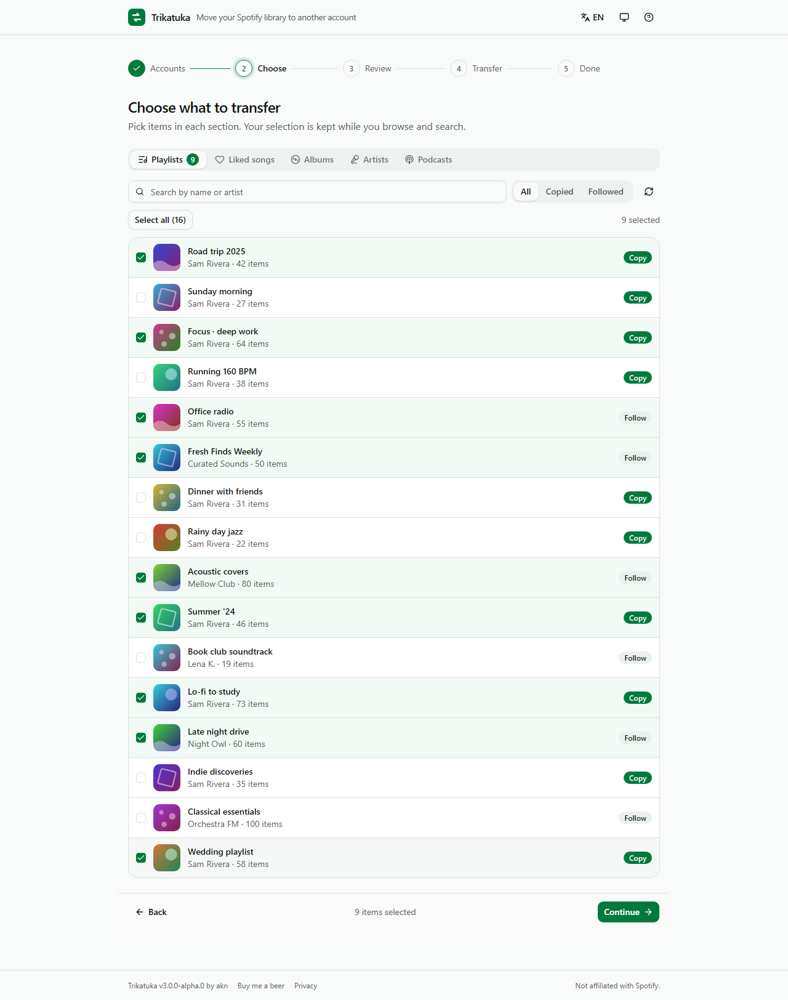

# Trikatuka – migration tool for Spotify

**Trikatuka** moves your Spotify library from one account to another: playlists, liked songs,
albums, followed artists and podcasts.

- Playlists you own are **copied** (name, visibility, description and songs).
- Collaborative playlists and playlists made by others are **followed**.
- It runs entirely in the browser; there is no backend.

**Production app:** https://trikatuka.aknakn.eu

How to: https://aknowakowski.blogspot.com/p/trikatuka2.html

## Screenshots

| Choose what to transfer                                                                     | Report                                                                         |
| ------------------------------------------------------------------------------------------- | ------------------------------------------------------------------------------ |
|  |  |

More in [docs/screenshots](docs/screenshots/), in English and Italian, light and dark, desktop
and mobile. They show a made-up library and are regenerated with `npm run screenshots`.

## For developers

Stack: React 19, TypeScript, Vite, Tailwind CSS 4, shadcn/ui, TanStack Query, Zustand,
react-i18next. Tests: Vitest and Playwright.

### Spotify app setup

1. Create an app on https://developer.spotify.com/dashboard and copy its **Client ID**.
2. Add these redirect URIs:
   - `http://127.0.0.1:5173/afterLogin` (development; Spotify only allows `http` on loopback
     IPs, not on `localhost`)
   - `https://<your-domain>/afterLogin` (production)
3. Put the Client ID in `.env.development` / `.env.production`:

   ```
   VITE_SPOTIFY_CLIENT_ID=<your client id>
   ```

   For a personal override, use `.env.development.local` (gitignored).

Apps in Spotify's development mode are limited to a few users, and the app owner needs Spotify
Premium. A public deployment needs extended quota mode.

### Commands

```bash
npm install
npm run dev          # http://127.0.0.1:5173
npm run build        # type check + production build in dist/
npm run preview      # serve dist/ on http://127.0.0.1:4173
npm run lint
npm run typecheck
npm run format       # Prettier
npm test             # unit tests (Vitest)
npm run test:e2e     # end-to-end + axe accessibility tests (Playwright, fake Spotify; builds first)
npm run screenshots  # regenerate docs/screenshots/ (demo library, all languages/themes)
```

The first time, install the Playwright browser with `npx playwright install chromium`. Set
`E2E_PORT` (default 4173) to serve the e2e and screenshot tests on another port.

### Advertising (optional)

The app can show one Google AdSense banner above the footer. It is **off by default**, and
while it is off nothing is loaded from Google. It is configured in `.env.production`:

```
VITE_ADSENSE_ENABLED=true                  # false = no ads
VITE_ADSENSE_CLIENT=ca-pub-XXXXXXXXXXXXXXXX
VITE_ADSENSE_SLOT=XXXXXXXXXX
VITE_ADSENSE_NON_PERSONALIZED=false        # true = non-personalized ads only
```

Rebuild and deploy after changing it. Before turning ads on for visitors in the EEA, UK or
Switzerland, set up a consent message (a Google-certified CMP, e.g. "Privacy & messaging" in
the AdSense account), and make sure the privacy policy matches what is enabled.

### Deploy

```bash
firebase deploy --only hosting   # runs npm run build first
```

`firebase emulators:start --only hosting` serves `dist/` locally with the rewrites, but the
local emulator does not apply the `redirects` and `headers` of `firebase.json`. Check those on a
preview channel (`firebase hosting:channel:deploy preview`).

## Adding a language

Translations live in `src/i18n/locales/`, one JSON file per language. Adding a language needs
no code changes:

1. Copy `src/i18n/locales/en.json` to `src/i18n/locales/<code>.json`, where `<code>` is a
   language code such as `de`, `pl` or `pt-BR`. The language menu shows its name automatically,
   in that language.
2. Translate the values. Keep the keys and the `{{placeholders}}` as they are.
3. Plurals: English has `_one` and `_other` forms. Provide exactly the forms your language uses
   (e.g. Polish needs `_one`, `_few`, `_many` and `_other`). If two forms read the same, repeat
   the text.
4. Run `npm test`. It checks every locale file and tells you what is missing or not allowed.

Translations are plain text: no HTML, no links. Each language is downloaded only by people who
use it.

## Versioning

The project follows [Semantic Versioning](https://semver.org/). Changes are recorded in
[CHANGELOG.md](CHANGELOG.md), in the [Keep a Changelog](https://keepachangelog.com/en/1.1.0/)
format. The version in `package.json` is the one shown in the app's footer.

## License

[MIT](LICENSE)
